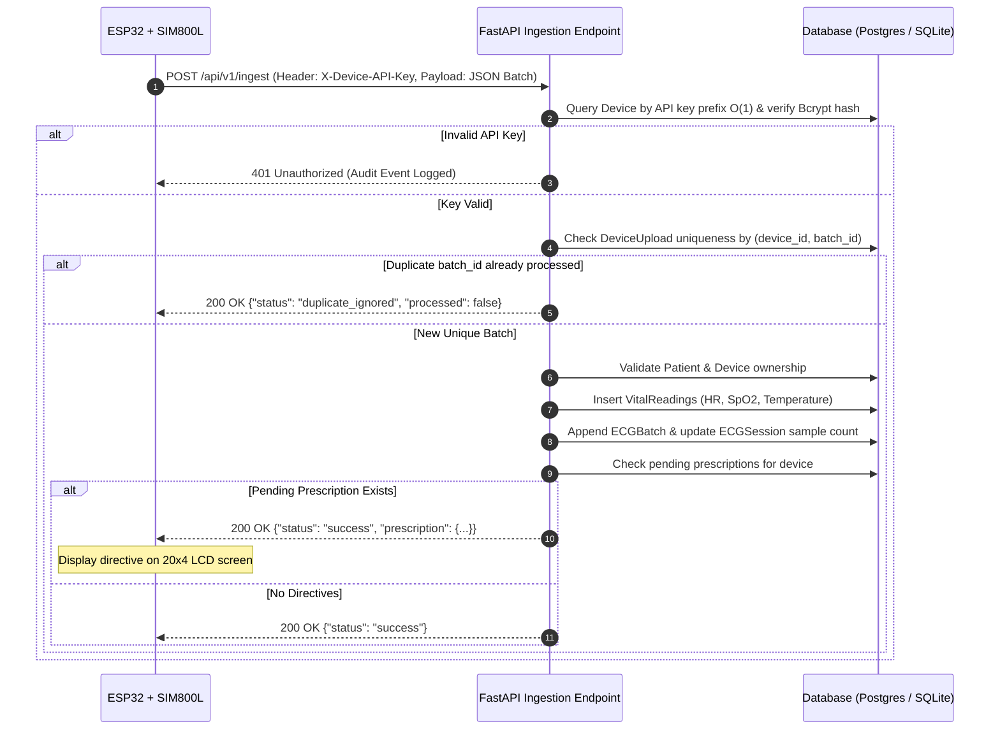
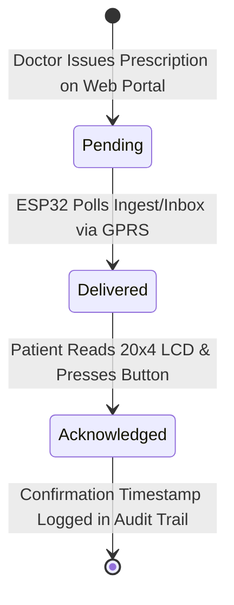

# System Architecture & Technical Specifications
## Remote Patient Health Monitoring System (IoT Telehealth Platform)

---

## 1. High-Level System Architecture

```mermaid
flowchart TD
    subgraph Hardware ["Edge IoT Subsystem (Rural Patient Home)"]
        Sensors["Biosensors: AD8232 (ECG) + MAX30102 (HR/SpO2) + DS18B20 (Temp)"]
        ESP32["ESP32 Microcontroller (Dual Core 240MHz, 250Hz ADC)"]
        LCD["20x4 I2C Character LCD (Patient Advice Display)"]
        Btn["Physical Acknowledge Button"]
        SIM800L["SIM800L 2G/GPRS Quad-Band GSM Modem"]
        
        Sensors --> ESP32
        Btn --> ESP32
        ESP32 --> LCD
        ESP32 <-->|UART 9600-115200| SIM800L
    end

    subgraph Network ["Carrier Network"]
        Cellular["2G/GPRS Cellular Base Station"]
        SIM800L <-->|PPP / AT Commands| Cellular
    end

    subgraph Backend ["FastAPI Cloud Telemetry Platform"]
        Gateway["Reverse Proxy / Uvicorn ASGI Server"]
        AuthLayer["Device Authentication: SHA256 Prefix + Bcrypt Hash"]
        IngestService["Ingest Pipeline & Idempotency Validator"]
        DSP["ECG Signal Engine: 0.5–40 Hz 4th-order SOS Butterworth"]
        PrescriptEngine["Prescription Dispatcher & Device Poller"]
        
        Cellular -->|HTTP POST /api/v1/ingest| Gateway
        Gateway --> AuthLayer
        AuthLayer --> IngestService
        IngestService --> DSP
    end

    subgraph Storage ["Persistence Layer (Dual Engine)"]
        DB[("PostgreSQL 16 (Neon.tech) / Local SQLite (aiosqlite)")]
        IngestService <--> DB
        PrescriptEngine <--> DB
    end

    subgraph Frontend ["Doctor Clinical Portal (React + Vite)"]
        Dashboard["Clinical Analytics & Live Telemetry KPI"]
        ECGViewer["Plotly 250Hz ECG Analyzer (Paper Grid & Lead-off)"]
        RxModal["Doctor Directive Dispatcher & 20x4 LCD Simulator"]
        
        Gateway <-->|REST API + JWT Bearer| Frontend
        Frontend --- Dashboard
        Frontend --- ECGViewer
        Frontend --- RxModal
    end
```

---

## 2. Ingestion & Duplicate-Safe Idempotency Sequence



---

## 3. ECG Signal Processing Pipeline

The system uses a biomedical signal conditioning pipeline to eliminate powerline interference and baseline wander without phase distortion:

```
[Raw ADC Counts from AD8232 @ 250 Hz]
              │
              ▼
    [Lead-Off Detection]
    (Check LO+ and LO- digital pins: GPIO 33 & 32)
              │
              ├── If Lead Off = TRUE ──> Mark Sample Gap & Discontinuity
              │
              ▼
    [Batch Chunk Aggregation]
    (100 to 500 samples per batch with timestamp & sequence number)
              │
              ▼
    [Transmission via SIM800L HTTP POST]
              │
              ▼
    [FastAPI Server Storage]
    (Original ADC counts preserved bit-for-bit in database)
              │
              ▼
    [Digital Signal Processing (DSP)]
    • 4th-order Second-Order Sections (SOS) Butterworth Bandpass
    • Passband: 0.5 Hz (cutoff baseline wander) to 40.0 Hz (eliminate 50/60Hz mains hum)
    • Zero-Phase Forward-Backward Filtering (scipy.signal.sosfiltfilt)
              │
              ▼
    [Interactive Visualization]
    • Dual Grid: Clinical Millimeter Paper Grid vs Midnight Dark Oscilloscope
    • Lead-Off Gaps rendered as clear discontinuities (no fabricated waveforms)
    • CSV raw numerical export & High-Resolution PNG strip export
```

---

## 4. Doctor-to-Patient Prescription Lifecycle



### 20x4 Character LCD Paging Scheme
The ESP32 renders directives across 4 sequential pages (20 characters × 4 lines):

| Page | Line 1 | Line 2 | Line 3 | Line 4 |
| :---: | :--- | :--- | :--- | :--- |
| **1/4** | `* DOCTOR ADVICE 1/4 *` | `Pt: P001` | `Rx: Mild Fever` | `[NEXT:btn1 CONF:btn2]` |
| **2/4** | `* MEDICINE 2/4 *` | `Med: Paracetamol` | `Dosage: 500mg 1Tab` | `[NEXT:btn1 CONF:btn2]` |
| **3/4** | `* SCHEDULE 3/4 *` | `Freq: 3 times daily` | `Dur: 5 days` | `[NEXT:btn1 CONF:btn2]` |
| **4/4** | `* DIRECTIVE 4/4 *` | `Ins: After meal` | `F/U: 2026-12-01` | `PRESS CONFIRM TO ACK` |

---

## 5. Security & Authentication Architecture

1. **Physician Web Dashboard Access**:
   - Authentication scheme: OAuth2 Password Bearer flow.
   - Passwords hashed using standard `bcrypt`.
   - Access tokens issued as signed HMAC-SHA256 JWT tokens with configurable expiration (`ACCESS_TOKEN_EXPIRE_MINUTES`).

2. **IoT Device Telemetry Ingestion**:
   - Hardware header: `X-Device-API-Key`.
   - Key format: `dev_<12_char_prefix>_<32_char_random_secret>`.
   - Lookup complexity: $O(1)$ fast prefix search in database, followed by timing-safe bcrypt hash verification of the secret.
   - Granular permissions: Each API key is scoped strictly to its assigned device and patient. Cross-device spoofing is rejected with HTTP 403/409.

3. **Immutable Audit Trail**:
   - All authentication failures, key rotations, and device data transmissions are logged in the `audit_events` table for regulatory traceability.
